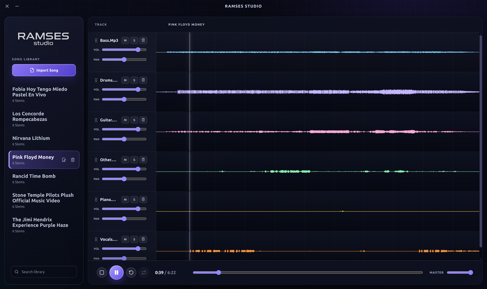

# Ramses Studio

<p align="center">
  
</p>

Ramses Studio is a desktop practice tool for musicians. Import a WAV, FLAC, or MP3 recording and the app uses local ONNX Runtime inference to separate it into individual stems. Load a song into the DAW-style timeline to mute, solo, pan, adjust levels, seek, and loop sections while practicing.

The application runs entirely on the desktop: songs and generated WAV stems remain on the local machine. The bundled six-stem HTDemucs model separates drums, bass, other, vocals, guitar, and piano.



## Requirements

- Node.js 20 or newer
- npm
- Git LFS


## Getting started

Clone the repository, download the LFS-managed model, and install dependencies:

```bash
git clone git@github.com:rramirezacosta/ramses-studio.git
cd ramses-studio
git lfs install
git lfs pull
npm install

```

YouTube audio is downloaded using a pure-JS YouTube extractor (no external binary required).

The Linux ffmpeg is required because sandboxed packages (Flatpak) cannot call the system ffmpeg; a static build (for example the one shipped at `node_modules/@ffmpeg-installer/linux-x64/ffmpeg`) works.

Creating a Flatpak additionally requires `flatpak` and `flatpak-builder` with the `org.freedesktop.Sdk` runtime installed on the build machine.


Start the Electron app in development mode:

```bash
npm run dev
```

## Building

Run the type check and production build:

```bash
npm run build
```

Create a distributable package:

| Platform | Command | Output |
| --- | --- | --- |
| Linux | `make linux` | AppImage in `release/` |
| Windows | `make windows` | Portable executable in `release/` |
| Linux (Flatpak) | `make flatpak` | Flatpak bundle in `release/` |
| Both | `make packages` | Linux AppImage, Flatpak, and Windows packages |

The equivalent npm commands are `npm run package:linux`, `npm run package:flatpak`, and `npm run package:windows`.

## Usage

1. Select **Import Audio** and choose a WAV, FLAC, or MP3 file.
2. Wait for separation to complete; the generated stems are added to the song library.
3. Select the song to open its tracks in the timeline.
4. Use **M** and **S** on each track to mute or solo it, adjust its volume and pan, and drag over a waveform to create a loop.

## Technology

- Electron, React, and Vite
- ONNX Runtime Node.js for local model inference
- HTDemucs six-stem ONNX model
- Web Audio API transport and mixing controls
